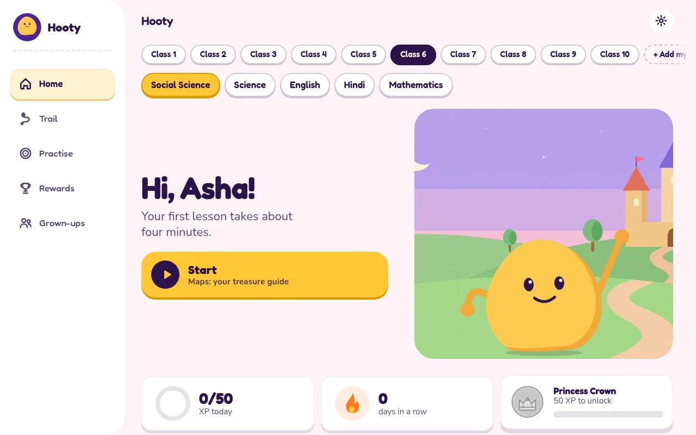
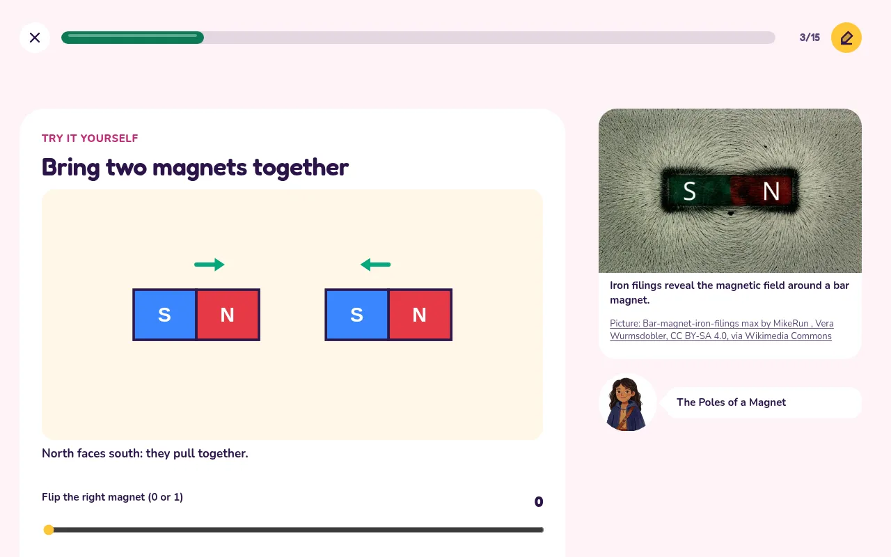
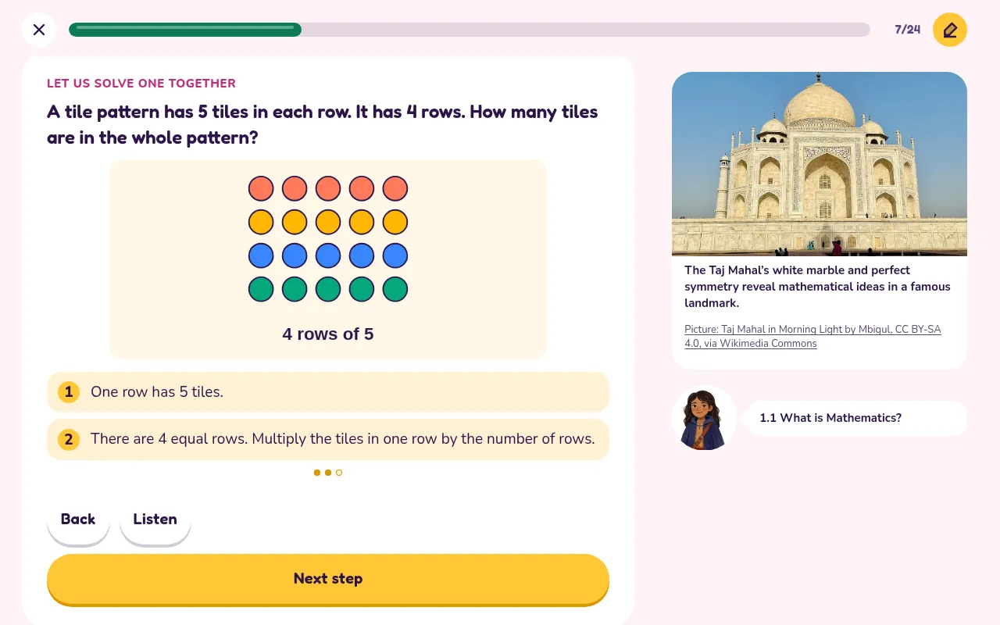
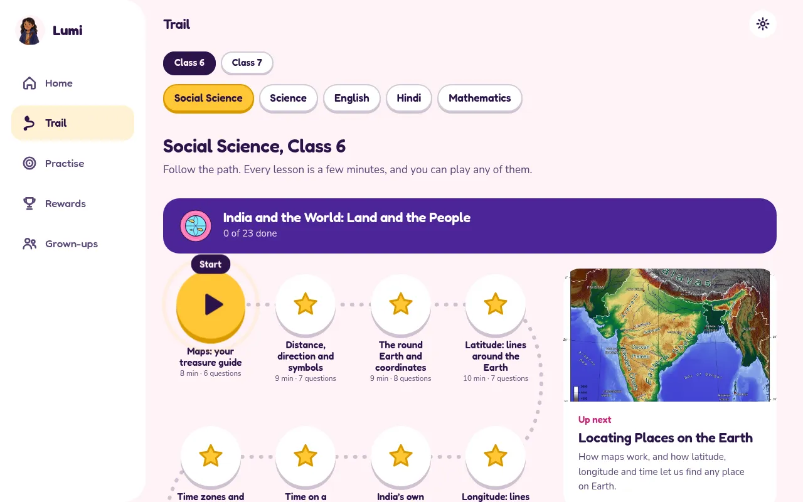
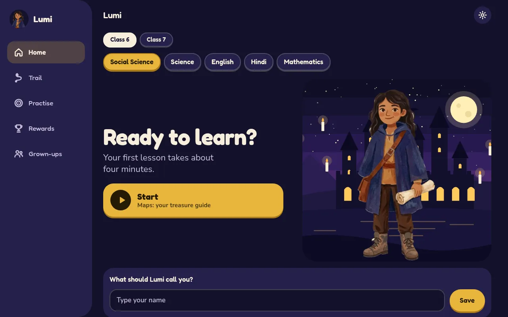
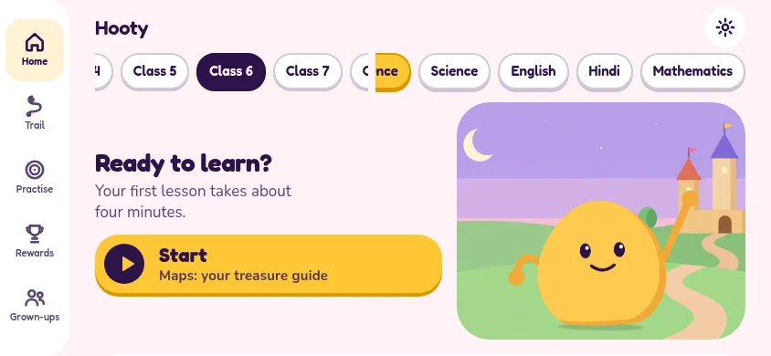

<div align="center">


# Hooty

### Your school books, turned into an adventure ✨

A free learning game for school children in India, built chapter by chapter from the NCERT textbooks.

**[▶ Play Hooty](https://hooty.org/)**

No sign-up. No ads. Nothing a child does ever leaves their device.

</div>

<br>



## 🌟 Meet your guide

Hooty, our round, sunny-yellow friend, walks beside the child through every lesson. Lumi, the young explorer, is there too, and each child can pick whichever guide they like in Settings. Either one asks a question that makes you curious, explains the idea in simple words, cheers when you get it, and shows you why when you don't.

The aim is simple: a child should understand the idea, not just remember the sentence. And they should still be ready for their school exams.

## 🎒 What's inside

| | |
|---|---|
| 🧲 **Play with the idea** | Simulations you can touch. Push two magnets together and watch them pull or push apart. |
| 🧮 **Maths explained step by step** | Hooty solves one with you, with a picture drawn from the problem's own numbers. Then you try, with fresh numbers every time. |
| 🤔 **Questions that make you think** | Predict what happens. Explain why. Spot the mistake. Many wrong answers tell you exactly why they were tempting. |
| 💬 **Very simple English** | Short sentences and everyday words, for children still learning English. School words stay, because exams need them. |
| 🎯 **Practice that means something** | Questions you got wrong wait for you. Get one right and it's gone. |
| 📝 **Ready for school tests** | Case studies, assertion and reason, and written answers you can check against the points a marker looks for. |
| 🔊 **Read aloud** | Hooty can read lessons to you, in English and Hindi. |
| 🏰 **Worlds and stickers** | Earn stickers and choose your world: a kingdom, deep space, the jungle, a calm lagoon or a moonlit academy. |

<table>
  <tr>
    <td width="50%"><br><sub><b>Try it yourself:</b> science you can poke</sub></td>
    <td width="50%"><br><sub><b>Solve one together:</b> see why it works, then do it</sub></td>
  </tr>
  <tr>
    <td><br><sub><b>The trail:</b> every chapter, one small step at a time</sub></td>
    <td><br><sub><b>Moonlit Academy:</b> one of five worlds to choose from</sub></td>
  </tr>
</table>

<div align="center">
  <br>
  <sub>Made for phones and tablets, upright or sideways, and for computers too</sub>
</div>

## 📚 Books so far

| Class | Mathematics | Science | Social Science | English | Hindi |
|:-----:|:-----------:|:-------:|:--------------:|:-------:|:-----:|
| **6** | ✅ | ✅ | ✅ | ✅ | ✅ |
| **7** | ✅ | ✅ | ✅ | ✅ | ✅ |
| **1 to 5, 8 to 10** | 🛠️ (Class 8 first) | 🛠️ | 🛠️ | 🛠️ | 🛠️ |

✅ on the site &nbsp;·&nbsp; 🛠️ being built, or waiting its turn

Classes 3 to 5 study The World Around Us in place of Science and Social Science. Classes 1 and 2 have Maths, English and Hindi.

## 📄 Bring your own textbook

Tap **+ Add my book**, choose the PDF of any school book, and Hooty turns it into lessons in seconds, right there on the device. There's no AI and no account, and the file is never uploaded.

Plain code finds the chapters, sections, key words, pictures and worked examples, then makes reading cards and questions from the sentences printed in the book, each with its page number. Text-based PDFs work best. Scanned photos of pages can't be read yet, and these lessons won't have the simulations or simpler English of the built-in books.

## 🔍 How we keep it true

A wrong fact taught to a child is worse than no fact at all, so AI writes the first draft and then has to get past some strict checks:

- 📖 Lesson facts trace back to the page of the textbook they came from.
- 🧮 In Maths problems with fresh numbers, the answer is worked out by code, not by a model. A second reader must also solve each one without seeing the answer.
- 🔢 When a question is rewritten in simpler English, code checks that its numbers and answer did not change.
- 🧪 Simulations are tested against what they are meant to show.
- 🖼️ Pictures are freely licensed and credited on the lesson that uses them.

It is not perfect yet. If you spot a mistake, please tell us.

## 🛠️ Run it yourself

```bash
python3 tools/serve.py
```

Plain JavaScript modules and no build step, so what you read is what runs.

The read-aloud recordings and the textbooks themselves aren't kept in this repo. `tools/make-audio.py` records the audio, and the tools download the books from [ncert.nic.in](https://ncert.nic.in/textbook.php).

| Folder | What lives there |
|---|---|
| `public/` | The app and the finished courses |
| `tools/` | Turns a textbook PDF into a course |
| `docs/PEDAGOGY.md` | How the lessons teach |
| `docs/INGEST.md` | How a book becomes a course |
| `docs/CONTENT-PIPELINE.md` | How the facts get checked |

## ⚖️ Licence

Free to use, study, change and share. Not for sale, and not for making money. The code is under the
[PolyForm Noncommercial licence](LICENSE) and Hooty's own writing and art under
[CC BY-NC-SA 4.0](LICENSE-CONTENT.txt). [NOTICE.md](NOTICE.md) says exactly what is covered, and what belongs to
others (the NCERT books and the pictures).

## 💛 Thank you

To NCERT for the textbooks every lesson is built on, and to the photographers and contributors on Wikimedia Commons and Openverse whose pictures make the lessons come alive.

<div align="center">
  <br>
  
  <br>
  <sub>Made with love, for every child who ever asked "but why?"</sub>
</div>
